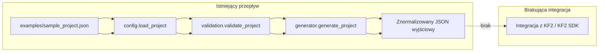
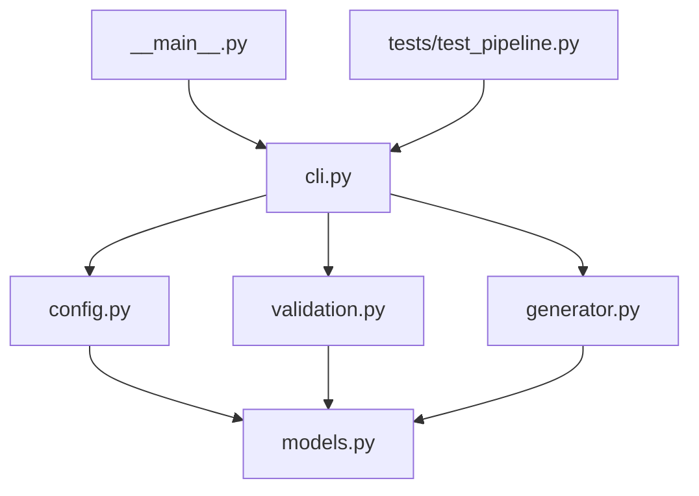

# ARCHITEKTURA PROJEKTU I INTEGRACJA Z KILLING FLOOR 2

- Nazwa repozytorium: Gpt
- Aktywna gałąź: main
- Data analizy: 2026-07-21
- Zakres analizy: aktualne pliki repozytorium, w szczególności pakiet `src/kf2_env_generator`, `examples`, `tests` i `pyproject.toml`; bez instalowania nowych zależności i bez uruchamiania buildów
- Krótkie podsumowanie stanu projektu: repozytorium zawiera już działający minimalny generator środowisk w Pythonie. Generator wczytuje JSON z opisem projektu, buduje model danych, waliduje odniesienia między encjami i zapisuje znormalizowany JSON wyjściowy. Nie ma jeszcze integracji z Killing Floor 2 ani z KF2 SDK.
- Znaleziono działający generator środowisk: Tak, w zakresie generowania i walidacji projektu JSON
- Znaleziono rzeczywistą integrację z KF2 lub KF2 SDK: Nie

## 1. Cel i zakres projektu

### Stan obecny
- Obecny system służy do opisu i wygenerowania prostego projektu środowiska w JSON.
- Główny przepływ obejmuje: wczytanie JSON, walidację podstawową, serializację modelu do znormalizowanego JSON.
- Projekt obsługuje: pomieszczenia, ściany, dekoracje, światła i punkty startowe.
- W repozytorium nie ma jeszcze geometrii silnikowej, navmesh, eksportu do KF2 ani warstwy integracyjnej z SDK.
- Jedynym wejściem użytkownika jest plik JSON projektu przekazany do CLI.

### Nieustalone
- Nieustalone jest, czy ten minimalny generator jest zalążkiem większego narzędzia, czy osobnym, celowo uproszczonym komponentem.
- Nieustalone są zasady jednostek i pełna semantyka współrzędnych, bo kod operuje wyłącznie na liczbach i nie opisuje skali świata.

### Rekomendowana architektura
- W przyszłości system powinien rozdzielać model domenowy, generowanie geometrii, rozmieszczanie obiektów, walidację i eksport do KF2 jako osobne warstwy.

## 2. Struktura katalogów

### Stan obecny
```text
Gpt/
├── ARCHITECTURE_KF2.md        # dokument architektury
├── examples/                  # przykładowe dane wejściowe
│   └── sample_project.json
├── pyproject.toml             # metadane pakietu i konfiguracja build systemu
├── src/
│   └── kf2_env_generator/     # pakiet generatora
│       ├── __init__.py
│       ├── __main__.py
│       ├── cli.py
│       ├── config.py
│       ├── generator.py
│       ├── models.py
│       └── validation.py
└── tests/
    └── test_pipeline.py       # test end-to-end uruchamiany jako proces CLI
```

### Opis najważniejszych elementów
- [pyproject.toml](pyproject.toml) — deklaruje build system `setuptools`, nazwę pakietu, wersję i minimalną wersję Pythona.
- [src/kf2_env_generator/models.py](src/kf2_env_generator/models.py) — definicje obiektów domenowych projektu.
- [src/kf2_env_generator/config.py](src/kf2_env_generator/config.py) — parser JSON i podstawowa walidacja składni i typów wejścia.
- [src/kf2_env_generator/validation.py](src/kf2_env_generator/validation.py) — walidacja relacji między encjami i wymaganych pól semantycznych.
- [src/kf2_env_generator/generator.py](src/kf2_env_generator/generator.py) — zapis znormalizowanego JSON wyjściowego.
- [src/kf2_env_generator/cli.py](src/kf2_env_generator/cli.py) — punkt wejścia CLI łączący parser, walidację i eksport.
- [examples/sample_project.json](examples/sample_project.json) — przykładowy, działający plik wejściowy.
- [tests/test_pipeline.py](tests/test_pipeline.py) — test procesu end-to-end uruchamiający CLI jako podproces.

### Nieustalone
- Nie ma katalogów dla zasobów silnikowych, map KF2, importów SDK ani build artefaktów przeznaczonych do wersjonowania.

## 3. Moduły systemu

### Stan obecny

#### `src/kf2_env_generator/models.py`
- Odpowiedzialność: model domenowy projektu.
- Wejście: obiekty tworzone przez parser JSON.
- Wyjście: dataclassowe reprezentacje używane przez walidację i generator.
- Format danych: `Room`, `Wall`, `SpawnPoint`, `Decoration`, `Light`, `EnvironmentProject`.
- Zależności: korzysta wyłącznie z biblioteki standardowej (`dataclasses`, `typing`).
- Skutek awarii: brak modelu uniemożliwia dalsze etapy pipeline’u.

#### `src/kf2_env_generator/config.py`
- Odpowiedzialność: odczyt JSON i budowa modelu projektu.
- Wejście: ścieżka do pliku JSON.
- Wyjście: `EnvironmentProject`.
- Format danych: JSON z kluczami `name`, `rooms`, `spawn_points`, `decorations`, `lights`.
- Najważniejsze funkcje: `load_project()`, `_is_coordinate_pair()`.
- Obsługa błędów: `ConfigError` dla braków, nieprawidłowych typów i niepoprawnych współrzędnych.
- Zależności: `models.py`.

#### `src/kf2_env_generator/validation.py`
- Odpowiedzialność: walidacja spójności modelu.
- Wejście: `EnvironmentProject`.
- Wyjście: brak wartości zwracanej; sukces oznacza brak wyjątku.
- Najważniejsza funkcja: `validate_project()`.
- Obsługa błędów: `ValidationError`.
- Zależności: `models.py`.

#### `src/kf2_env_generator/generator.py`
- Odpowiedzialność: serializacja modelu do znormalizowanego JSON.
- Wejście: `EnvironmentProject` i ścieżka wyjściowa.
- Wyjście: plik JSON oraz zwrócona ścieżka `Path`.
- Najważniejsza funkcja: `generate_project()`.
- Obsługa błędów: `GenerationError` przy braku pomieszczeń.
- Zależności: `models.py`.
- Skutek awarii: brak pliku wyjściowego lub zapis niekompletnego projektu.

#### `src/kf2_env_generator/cli.py`
- Odpowiedzialność: spina parser, walidację i generator w jeden proces CLI.
- Wejście: dwa argumenty pozycyjne `input_path` i `output_path`.
- Wyjście: komunikat na stdout i kod wyjścia `0` przy sukcesie.
- Obsługa błędów: `parser.exit(1, ...)` dla błędów konfiguracji, walidacji i generowania.
- Zależności: `config.py`, `validation.py`, `generator.py`.

#### `src/kf2_env_generator/__main__.py`
- Odpowiedzialność: umożliwia uruchomienie pakietu przez `python -m kf2_env_generator`.
- Zależności: `cli.py`.

#### `tests/test_pipeline.py`
- Odpowiedzialność: test uruchamiający CLI jako podproces.
- Wejście: [examples/sample_project.json](examples/sample_project.json).
- Wyjście: oczekiwany plik JSON generowany w katalogu tymczasowym.
- Uwaga: plik odwołuje się do `os.name`, ale nie importuje `os`; test w obecnej postaci wymaga poprawki, aby być w pełni uruchamialny.

### Nieustalone
- Nie ma jeszcze podziału na osobne moduły dla geometrii, kolizji, nawigacji, eksportu KF2 ani rejestru zasobów.

### Rekomendowana architektura
- Obecny podział jest prosty i liniowy, dlatego dalsza rozbudowa powinna zachować separację modelu, parsera, walidacji, generatora i warstwy integracyjnej KF2.

## 4. Dane wejściowe

### Stan obecny
- Jedynym obsługiwanym formatem wejścia jest JSON.
- Format wejściowy jest zdefiniowany przez [examples/sample_project.json](examples/sample_project.json) i implementację w [src/kf2_env_generator/config.py](src/kf2_env_generator/config.py).
- Wymagane pola projektu: `name` oraz co najmniej jeden element w `rooms` dla późniejszego generowania.
- Wymagane pola pokoju: `id`, `name`, `width`, `height`, `depth`.
- Opcjonalne pola pokoju: `walls`, `decorations`, `lights`.
- Wymagane pola ściany: `start`, `end`; opcjonalne `height` z domyślną wartością `256.0`.
- Wymagane pola punktu startowego, dekoracji i światła: `id`, `room_id`, współrzędne, a dla dekoracji i świateł także `name`.
- Opcjonalne pole światła: `intensity` z domyślną wartością `1.0`.
- `room.decorations` i `room.lights` są przechowywane jako listy identyfikatorów, ale nie są wiązane z obiektami top-level podczas walidacji.

### Nieustalone
- Nie ma osobnego schematu JSON Schema ani YAML, więc formalna specyfikacja formatu nie istnieje poza kodem i przykładem.
- Nieustalone są jednostki, skala i konwencja osi świata; kod zachowuje liczby, ale ich znaczenie nie jest opisane.

### Rekomendowana architektura
- Jeśli format ma rosnąć, warto dodać osobny schemat wejściowy, wersjonowanie formatu i walidację schematową przed budową modelu domenowego.

## 5. Przepływ generowania środowiska

### Stan obecny
Rzeczywisty przepływ wygląda następująco:
1. użytkownik uruchamia `python -m kf2_env_generator` lub `python -m kf2_env_generator.cli`,
2. `cli.py` wywołuje `load_project()` z `config.py`,
3. `config.py` parsuje JSON i buduje `EnvironmentProject`,
4. `validation.py` sprawdza spójność referencji i podstawowe warunki,
5. `generator.py` serializuje wynik do pliku JSON,
6. CLI wypisuje ścieżkę do pliku wyjściowego.

Miejsce zakończenia rzeczywistego przepływu: zapis znormalizowanego JSON. Integracja z KF2 nie istnieje.

### Diagram Mermaid — stan obecny


### Nieustalone
- Nie ma jeszcze etapu budowy geometrii silnikowej, eksportu do formatu KF2 ani uruchomienia w grze.

### Rekomendowana architektura
- Następnym krokiem powinien być oddzielny etap eksportu do formatu pośredniego, a dopiero potem warstwa mapowania do KF2 SDK.

## 6. Model mapy i formaty danych

### Stan obecny
- Wewnętrzny model generatora znajduje się w [src/kf2_env_generator/models.py](src/kf2_env_generator/models.py).
- Format wejściowy i wyjściowy są JSON-owe i praktycznie zbliżone do siebie.
- W modelu występują:
  - `EnvironmentProject` z listami `rooms`, `spawn_points`, `decorations`, `lights`,
  - `Room` z wymiarami i listą ścian,
  - `Wall` z parą punktów 2D i wysokością,
  - `SpawnPoint`, `Decoration`, `Light` z pozycją 3D.
- `generator.py` zachowuje strukturę logiczną danych, ale normalizuje wartości liczbowe do `float`.
- Nie istnieje oddzielny format końcowy dla KF2.

### Przykład z repozytorium
Przykładowa lokacja z [examples/sample_project.json](examples/sample_project.json):
```json
{
  "id": "room_01",
  "name": "Main Hall",
  "width": 1200,
  "height": 400,
  "depth": 900,
  "walls": [
    {"start": [0, 0], "end": [1200, 0], "height": 256}
  ]
}
```

Przykładowy obiekt z [examples/sample_project.json](examples/sample_project.json):
```json
{
  "id": "crate_01",
  "room_id": "room_01",
  "name": "crate",
  "x": 400,
  "y": 50,
  "z": 0
}
```

### Nieustalone
- Nie ustalono formalnych jednostek, systemu współrzędnych ani zasad rotacji/skali.
- Nie istnieje osobny format „lokacji” lub „obiektów” poza tymi czterema typami encji.

### Rekomendowana architektura
- Docelowo warto rozdzielić format wejściowy, model pośredni i format eksportu tak, aby inne narzędzia nie zależały od wewnętrznego JSON-a projektu.

## 7. Sposób dodawania elementów mapy

### Stan obecny

| Element | Stan obecny | Odpowiedzialny kod | Uwagi |
| --- | --- | --- | --- |
| Podłoże | brak osobnego modelu | `Room.width`, `Room.depth` w [models.py](src/kf2_env_generator/models.py) | podłoże jest tylko pośrednio reprezentowane przez wymiary pokoju |
| Ściany | zaimplementowane | `Wall`, `config.load_project()`, `generator.generate_project()` | ściany mają `start`, `end`, `height` |
| Sufity | brak implementacji | brak | nie ma osobnego obiektu sufitu |
| Drzwi | brak implementacji | brak | brak modelu przejść jako osobnych encji |
| Przejścia | brak implementacji | brak | brak topologii połączeń między pokojami |
| Schody | brak implementacji | brak | brak geometrii wielopoziomowej |
| Rampy | brak implementacji | brak | brak geometrii pochyłej |
| Poziomy wysokości | częściowo pośrednio | `Room.height` | to wymiar bryły, nie osobny system pięter |
| Dekoracje | zaimplementowane | `Decoration`, `decorations` w `Room` | top-level dekoracje są zachowywane w JSON |
| Rekwizyty | częściowo jako dekoracje | `Decoration` | nie ma osobnej klasy rekwizytów |
| Światła | zaimplementowane | `Light` | z opcjonalnym `intensity` |
| Kolizje | brak implementacji | brak | nie ma generatora kolizji |
| Punkty startowe graczy | zaimplementowane | `SpawnPoint` | walidowane względem istniejących pokoi |
| NPC | brak implementacji | brak | brak encji AI |
| Przeciwnicy | brak implementacji | brak | brak systemu spawnów przeciwników |
| Punkty spawnu | zaimplementowane | `SpawnPoint` | tylko jako proste punkty pozycyjne |
| Obszary spawnu | brak implementacji | brak | brak objętościowych stref spawnów |
| Ścieżki | brak implementacji | brak | brak grafu połączeń |
| Dane nawigacyjne | brak implementacji | brak | brak navmesha |
| Cele | brak implementacji | brak | brak systemu misji/trygerów celu |
| Triggery | brak implementacji | brak | brak encji aktywowanych zdarzeń |
| Elementy interaktywne | brak implementacji | brak | brak interakcji runtime |
| Dźwięki | brak implementacji | brak | brak powiązania z assetami audio |
| Efekty | brak implementacji | brak | brak systemu efektów |
| Elementy specyficzne dla KF2 | brak implementacji | brak | brak jakiejkolwiek warstwy KF2 |

### Nieustalone
- Nie ma jeszcze żadnego kodu dla geometrii pochodnej, kolizji, nawigacji ani logiki interakcji.

### Rekomendowana architektura
- Dalszy rozwój powinien dodać osobne generatory dla geometrii, kolizji, dekoracji i integracji z docelowym formatem KF2.

## 8. Zależności między plikami i modułami

### Stan obecny
- `__main__.py` importuje `main` z `cli.py`.
- `cli.py` importuje `load_project`, `validate_project` i `generate_project`.
- `config.py`, `generator.py` i `validation.py` importują `models.py`.
- `tests/test_pipeline.py` uruchamia CLI jako podproces i sprawdza wygenerowany JSON.
- Zewnętrzne zależności runtime są praktycznie zerowe: tylko biblioteka standardowa.
- `pyproject.toml` używa `setuptools` jako backendu build systemu.

### Diagram Mermaid — zależności obecne


### Nieustalone
- Nie ma cykli zależności w obecnym układzie, ale dalsza rozbudowa może je łatwo wprowadzić, jeśli nie zostanie zachowana separacja modelu i warstw I/O.

### Rekomendowana architektura
- Zmiana modelu danych powinna propagować się przez `models.py`, `config.py`, `validation.py` i `generator.py`.
- Zmiana formatu eksportu powinna dotyczyć głównie warstwy generatora i przyszłego modułu integracji KF2.

## 9. Uruchamianie projektu

### Stan obecny
- Wymagany jest Python 3.10 lub nowszy, zgodnie z `pyproject.toml`.
- Build backend: `setuptools`.
- Pakiet można zainstalować lokalnie w trybie editable przez `pip install -e .`.
- Główna komenda uruchomienia: `python -m kf2_env_generator <input.json> <output.json>`.
- Alternatywnie można uruchomić `python -m kf2_env_generator.cli ...`, jeśli `src` jest na ścieżce importu.
- Wyjście jest wypisywane na stdout; nie ma dedykowanego systemu logów.
- Plik wyjściowy tworzony jest pod wskazaną ścieżką, a katalog nadrzędny jest tworzony automatycznie.
- Nie ma osobnej konfiguracji środowiskowej ani zmiennych środowiskowych wymaganych przez aplikację.
- Testy istnieją w `tests/`, ale `pytest` nie jest zadeklarowany w `pyproject.toml`.

### Nieustalone
- Nie ma jeszcze oficjalnej komendy dla pełnego pipeline’u KF2, bo taka warstwa nie istnieje.
- Test `tests/test_pipeline.py` w obecnej postaci wymaga poprawki importu `os`, jeśli ma być uruchamiany bez błędu.

### Rekomendowana architektura
- Jeśli projekt będzie rósł, warto dodać jawny punkt wejścia CLI w `pyproject.toml` oraz osobne zależności dla testów i ewentualnych narzędzi eksportowych.

## 10. Zapisywanie, eksport i ponowne wczytywanie

### Stan obecny
- Niedokończona mapa nie ma osobnego formatu roboczego; jedynym stanem wejściowym jest JSON projektu.
- Gotowa mapa jest zapisywana jako znormalizowany JSON przez `generator.generate_project()`.
- Ponowne wczytanie projektu polega na ponownym uruchomieniu `load_project()` na tym samym lub innym JSON-ie wejściowym.
- Eksport ma identyczną strukturę logiczną jak wejście, ale wartości liczbowe są serializowane jako `float`.
- Dane mogą zostać częściowo znormalizowane: np. int → float, tuple → lista w wyjściowym JSON.
- Nie ma eksportu do formatu KF2 i nie ma procesu otwierania w edytorze silnika.

### Nieustalone
- Nie ma mechanizmu wersjonowania projektu ani migracji między formatami.

### Rekomendowana architektura
- Docelowo trzeba rozdzielić: zapis roboczy, eksport pośredni i eksport końcowy do KF2.

## 11. Walidacja mapy

### Stan obecny
- `config.py` sprawdza poprawność JSON, typów i niektórych ograniczeń strukturalnych.
- `validation.py` sprawdza:
  - niepustą nazwę projektu,
  - dodatnie wymiary pokoju,
  - zgodność `room_id` dla `SpawnPoint`, `Decoration` i `Light` z istniejącym pokojem.
- Walidacja jest uruchamiana przed generowaniem przez `cli.py`.
- Błędy są raportowane jako wyjątki `ConfigError`, `ValidationError` i `GenerationError`, a CLI kończy się kodem `1`.

### Nieustalone
- Nie ma walidacji nakładania się obiektów, błędnych kolizji, dostępności przestrzeni, połączeń nawigacyjnych ani zgodności z KF2.
- `room.decorations` i `room.lights` nie są sprawdzane względem top-level obiektów, więc spójność tych referencji pozostaje niezweryfikowana.

### Rekomendowana architektura
- W kolejnym kroku warto dodać osobny walidator geometryczny oraz walidację spójności referencji między `Room` a dekoracjami/światłami.

## 12. Przykład od początku do końca

### Stan obecny
Możliwy do wykonania rzeczywisty przebieg:
1. przygotowanie minimalnego JSON-a na podstawie [examples/sample_project.json](examples/sample_project.json),
2. uruchomienie `python -m kf2_env_generator examples/sample_project.json out/generated_project.json`,
3. zapis znormalizowanego pliku JSON.

Przykład kończy się na eksporcie JSON. Nie ma jeszcze kroku uruchomienia w KF2.

### Przykład z repozytorium
Zestaw obejmuje już:
- jedno pomieszczenie (`room_01`),
- cztery ściany obwodu,
- jedną dekorację (`crate_01`),
- jedno światło (`light_01`),
- jeden punkt startowy (`spawn_01`).

### Rekomendowana architektura
- Dopiero po dodaniu warstwy KF2 ten sam przykład powinien być rozszerzony o eksport do formatu docelowego silnika i test uruchomieniowy w środowisku KF2.

## 13. Mapa orientacyjna dla kolejnego agenta AI

### Jak rozpocząć poznawanie repozytorium
1. Przeczytać [pyproject.toml](pyproject.toml), aby zrozumieć sposób budowy pakietu.
2. Przeczytać [src/kf2_env_generator/models.py](src/kf2_env_generator/models.py), aby poznać model danych.
3. Przeczytać [src/kf2_env_generator/config.py](src/kf2_env_generator/config.py), aby zrozumieć format wejścia.
4. Przeczytać [src/kf2_env_generator/validation.py](src/kf2_env_generator/validation.py), aby poznać reguły spójności.
5. Przeczytać [src/kf2_env_generator/generator.py](src/kf2_env_generator/generator.py), aby zobaczyć sposób eksportu.
6. Przeczytać [src/kf2_env_generator/cli.py](src/kf2_env_generator/cli.py), aby zrozumieć przepływ uruchomienia.
7. Na końcu sprawdzić [examples/sample_project.json](examples/sample_project.json) i [tests/test_pipeline.py](tests/test_pipeline.py).

### Pięć najważniejszych plików do przeczytania
1. [src/kf2_env_generator/models.py](src/kf2_env_generator/models.py) — centralny model domenowy.
2. [src/kf2_env_generator/config.py](src/kf2_env_generator/config.py) — definiuje wejście i ograniczenia parsowania.
3. [src/kf2_env_generator/validation.py](src/kf2_env_generator/validation.py) — pokazuje reguły spójności projektu.
4. [src/kf2_env_generator/generator.py](src/kf2_env_generator/generator.py) — opisuje aktualny eksport do JSON.
5. [src/kf2_env_generator/cli.py](src/kf2_env_generator/cli.py) — integruje cały pipeline i pokazuje punkt startowy.

### Gdzie należałoby dodawać nowe generatory
- Najpierw w osobnych modułach obok `generator.py`, a potem ewentualnie jako podmoduły per typ elementu mapy.

### Gdzie zmienia się format danych
- W praktyce w `models.py`, `config.py`, `validation.py` i `generator.py`.

### Gdzie znajduje się walidacja
- Podstawowa walidacja parsowania: `config.py`.
- Walidacja semantyczna: `validation.py`.

### Gdzie znajduje się eksport
- `generator.py`.

### Gdzie rozszerzać eksport do KF2
- Najlepiej dodać nowy moduł, np. `src/kf2_env_generator/kf2_export.py`, który przyjmie model lub format pośredni i przetworzy go do artefaktów KF2.

### Co jest generowane automatycznie i czego nie należy edytować ręcznie
- `out/` i inne katalogi wynikowe tworzone przez uruchomienie CLI.
- `__pycache__/`.
- Pliki wynikowe wygenerowane przez `generator.py`.

### Zasoby zewnętrzne
- Na ten moment brak zewnętrznych zasobów silnikowych, bibliotek runtime i SDK KF2.

### Obszary wymagające ostrożności
- `models.py` i `config.py`, bo zmiana schematu wejścia natychmiast wpływa na parser i generator.
- `validation.py`, bo to tutaj decyzje o dopuszczalności danych zatrzymują pipeline.

## 14. Braki i kwestie nieustalone

| Brakująca informacja | Miejsce, w którym jej szukano | Wpływ braku tej informacji | Sposób możliwego ustalenia |
| --- | --- | --- | --- |
| Jednostki i skala świata | `models.py`, `config.py`, `examples/sample_project.json` | Nie można pewnie interpretować współrzędnych | Doprecyzowanie w dokumentacji lub schemacie formatu |
| Formalny schemat wejścia | `config.py`, `examples/sample_project.json` | Format może ewoluować bez wersjonowania | Dodanie JSON Schema lub równoważnego opisu |
| Integracja z KF2 | cały pakiet `src/kf2_env_generator` | Nie ma kroku uruchomienia w grze ani eksportu silnikowego | Dodanie modułu eksportu i dokumentacji KF2 |
| Walidacja referencji `Room.decorations` / `Room.lights` | `config.py`, `validation.py` | Możliwa niespójność między listą identyfikatorów a obiektami top-level | Rozszerzenie walidatora |
| Uruchamialność testów | `tests/test_pipeline.py`, `pyproject.toml` | Test pipeline może nie działać bez poprawki importu `os` i bez `pytest` | Naprawa testu i deklaracja zależności testowych |

## 15. Rekomendowana architektura brakującej części

### Uwaga
Ta sekcja opisuje wyłącznie brakującą warstwę dla pełnej integracji z KF2. Nie jest to opis obecnego kodu.

### 1. Model domenowy rozszerzony
- Odpowiedzialność: pełny model lokacji, sekcji, przejść, kolizji, spawnów i punktów logicznych.
- Wejście: obecny JSON projektu.
- Wyjście: model bogatszy niż obecne `Room`/`Wall`/`Decoration`/`Light`.
- Proponowane miejsce: nowe moduły obok `models.py`.

### 2. Generator geometrii
- Odpowiedzialność: budowa podłóg, sufitów, ścian, otworów i brył pomocniczych.
- Wejście: rozszerzony model domenowy.
- Wyjście: geometria pośrednia.
- Proponowane miejsce: `src/kf2_env_generator/geometry/`.

### 3. System rozmieszczania elementów
- Odpowiedzialność: lokowanie dekoracji, świateł, spawnów i obiektów interaktywnych.
- Wejście: geometria i model domenowy.
- Wyjście: lista obiektów sceny.
- Proponowane miejsce: `src/kf2_env_generator/placement/`.

### 4. Walidator rozszerzony
- Odpowiedzialność: kolizje, dostępność, referencje, poprawność przestrzenna, reguły KF2.
- Wejście: model i geometria pośrednia.
- Wyjście: raport błędów i ostrzeżeń.
- Proponowane miejsce: `src/kf2_env_generator/validation/`.

### 5. Rejestr zasobów
- Odpowiedzialność: mapowanie assetów na identyfikatory i ścieżki eksportowe.
- Wejście: konfiguracja zasobów.
- Wyjście: uporządkowany katalog assetów.
- Proponowane miejsce: `src/kf2_env_generator/assets/`.

### 6. Eksporter pośredni
- Odpowiedzialność: zapis stabilnego formatu pośredniego przed eksportem do KF2.
- Wejście: zwalidowany model i geometria pośrednia.
- Wyjście: format pośredni niezależny od silnika.
- Proponowane miejsce: `src/kf2_env_generator/export/`.

### 7. Integracja z KF2 SDK
- Odpowiedzialność: przekształcenie formatu pośredniego do artefaktów wymaganych przez KF2 lub narzędzia współpracujące z KF2.
- Wejście: format pośredni.
- Wyjście: artefakty docelowe dla KF2.
- Proponowane miejsce: `src/kf2_env_generator/kf2/`.

### 8. Raportowanie i logowanie
- Odpowiedzialność: zbieranie błędów, ostrzeżeń, metryk i śladu wykonania.
- Wejście: komunikaty z całego pipeline’u.
- Wyjście: raport lub log procesu.
- Proponowane miejsce: `src/kf2_env_generator/reporting/`.

### Podsumowanie
- Obecny kod daje solidny, działający start dla generatora JSON.
- Brakuje jeszcze pełnej geometrii, walidacji przestrzennej i szczególnie warstwy eksportu do KF2.
