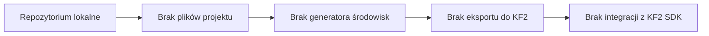
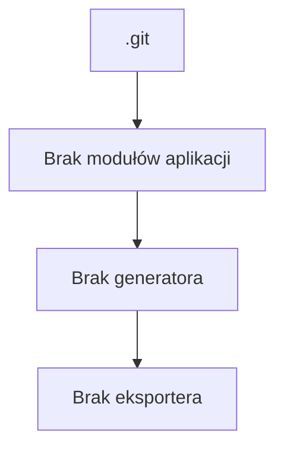

# ARCHITEKTURA PROJEKTU I INTEGRACJA Z KILLING FLOOR 2

- Nazwa repozytorium: Gpt
- Aktywna gałąź: main
- Data analizy: 2026-07-20
- Zakres analizy: wyłącznie pliki obecne w repozytorium lokalnym; bez instalacji zależności, uruchamiania buildów ani modyfikacji kodu
- Krótkie podsumowanie stanu projektu: repozytorium nie zawiera kodu źródłowego projektu, plików projektu, konfiguracji generatora ani zasobów związanych z Killing Floor 2. Obecnie jest to stan bardzo wczesny lub puste repozytorium z metadanymi Git.
- Znaleziono działający generator środowisk: Nie
- Znaleziono rzeczywistą integrację z KF2 lub KF2 SDK: Nie

## 1. Cel i zakres projektu

### Stan obecny
- Repozytorium nie zawiera aktualnego projektu aplikacji ani narzędzia do generowania map lub środowisk.
- Nie znaleziono skryptów, modułów, modeli danych ani konfiguracji odpowiadających za mapy, lokacje, obiekty, eksport lub integrację z KF2.
- Nie znaleziono świadomie istniejących plików takich jak README, AGENTS.md, CONTRIBUTING, docs ani konfiguracji projektu.

### Nieustalone
- Nie da się ustalić, czy projekt miał istnieć wcześniej w innym repozytorium lub gałęzi, ponieważ aktualny stan Git nie zawiera żadnych commitów z plikami projektu.
- Nie da się ustalić intencji autora projektu na podstawie samego repozytorium.

### Rekomendowana architektura
- Dla przyszłego generatora środowisk zgodnego z KF2 należy założyć osobny system do modelowania map, konfiguracji sceny, walidacji, eksportu i integracji z KF2 SDK. Ta część jest opisana osobno w sekcji 15.

## 2. Struktura katalogów

### Stan obecny
```text
Gpt/
└── .git/                  # metadane repozytorium Git
```

### Opis najważniejszych elementów
- [.git](.git) — katalog Git z historią repozytorium, konfiguracją i metadanymi; nie zawiera plików projektowych w aktualnym stanie.

### Nieustalone
- Brak katalogów źródłowych, testów, dokumentacji projektowej lub danych wejściowych.

## 3. Moduły systemu

### Stan obecny
Nie znaleziono rzeczywistych modułów aplikacji.

Można wskazać jedynie:
- metadane Git jako warstwę kontroli wersji,
- brak komponentów aplikacyjnych, generatora map, eksportera, walidatora lub integracji z KF2.

### Nieustalone
- Nie da się zidentyfikować żadnych klas, funkcji ani modułów implementujących logikę generowania środowiska.

### Rekomendowana architektura
- Przyszła architektura powinna być podzielona na osobne moduły, opisane w sekcji 15.

## 4. Dane wejściowe

### Stan obecny
- Nie znaleziono definicji danych wejściowych generatora.
- Nie znaleziono plików JSON, YAML, XML, CSV ani innych formatów opisu mapy lub środowiska.
- Nie znaleziono przykładowych konfiguracji.

### Nieustalone
- Nie da się ustalić, jak miały wyglądać dane wejściowe dla generatora, ponieważ nie ma ich w repozytorium.

### Rekomendowana architektura
- W przyszłości dane wejściowe powinny być opisywane w jednym, dobrze zdefiniowanym formacie, np. JSON lub YAML, z osobnymi sekcjami dla:
  - geometrii pomieszczeń,
  - obiektów dekoracyjnych,
  - punktów startowych,
  - spawnu przeciwników,
  - ustawień światła i kolizji,
  - ustawień eksportu.

## 5. Przepływ generowania środowiska

### Stan obecny
Rzeczywisty przepływ obecnego repozytorium kończy się na samym istnieniu metadanych Git. Nie ma żadnego procesu:
- wejścia danych,
- konfiguracji,
- modelowania mapy,
- generowania geometrii,
- rozmieszczania elementów,
- walidacji,
- eksportu,
- uruchomienia w KF2.

### Diagram Mermaid — stan obecny


### Nieustalone
- Nie da się wskazać żadnego rzeczywistego etapu przetwarzania, ponieważ nie ma implementacji.

### Rekomendowana architektura
- Przyszły przepływ powinien być realizowany etapami:
  1. dane wejściowe,
  2. konfiguracja,
  3. model mapy,
  4. generowanie geometrii,
  5. rozmieszczanie elementów,
  6. walidacja,
  7. eksport,
  8. test lub uruchomienie w KF2.

## 6. Model mapy i formaty danych

### Stan obecny
- Nie znaleziono modelu mapy.
- Nie znaleziono definicji formatu lokacji, obiektu, projektu ani eksportu.
- Nie znaleziono plików w formatach JSON, YAML, XML, CSV lub binarnych związanych z mapą.

### Nieustalone
- Nie da się ustalić, czy projekt miał używać konkretnego formatu pośredniego lub końcowego dla KF2.

### Rekomendowana architektura
- W przyszłości warto rozdzielić formaty na:
  - wewnętrzny model generatora,
  - format pośredni zapisu projektu,
  - końcowy format eksportu do KF2 lub jego SDK.
- Wewnętrzny model powinien zawierać obiekty takie jak pomieszczenia, ściany, przejścia, dekoracje, punkty startowe, punkty spawnu i triggery.

## 7. Sposób dodawania elementów mapy

### Stan obecny
- Brak implementacji jakiegokolwiek sposobu tworzenia podłoża, ścian, sufitu, drzwi, przejść, schodów, ramp, poziomów wysokości, dekoracji, rekwizytów, świateł, kolizji, punktów startowych graczy, NPC, przeciwników, ścieżek, danych nawigacyjnych, celów, triggerów, dźwięków, efektów lub innych elementów specyficznych dla KF2.

### Stan obecny: brak implementacji
- Wszystkie wymienione elementy są obecnie nieobsługiwane, ponieważ w repozytorium nie ma kodu ani definicji danych.

### Rekomendowana architektura
- Dla każdej klasy elementów należy dodać osobny moduł lub komponent w generatorze, np.:
  - generator geometrii pomieszczeń,
  - system dekoracji,
  - system spawnów i punktów startowych,
  - system kolizji i nawigacji,
  - system eksportu obiektów do formatu pośredniego KF2.

## 8. Zależności między plikami i modułami

### Stan obecny
- Brak zależności między modułami, ponieważ nie ma modułów.
- Brak importów aplikacyjnych, brak narzędzi zewnętrznych używanych w projekcie.

### Diagram Mermaid — zależności obecne


### Nieustalone
- Nie da się wskazać krytycznych punktów sprzężenia, ponieważ nie ma kodu projektowego.

### Rekomendowana architektura
- Po implementacji należy zachować wyraźne rozdzielenie między:
  - modelem mapy,
  - parserem konfiguracji,
  - generatorem geometrii,
  - systemem rozmieszczania obiektów,
  - walidatorem,
  - eksportem,
  - integracją z KF2 SDK.

## 9. Uruchamianie projektu

### Stan obecny
- Nie znaleziono instrukcji uruchomienia.
- Nie znaleziono wymagań środowiskowych.
- Nie znaleziono zależności, zmiennych środowiskowych ani komend startowych.

### Nieustalone
- Nie da się ustalić, jak uruchomić projekt, ponieważ nie istnieje żadny skrypt startowy ani plik konfiguracji runtime.

### Rekomendowana architektura
- Przyszły generator powinien mieć:
  - jedno miejsce wejścia, np. skrypt CLI lub punkt wejścia aplikacji,
  - plik konfiguracyjny wejściowy,
  - katalog wyjściowy dla wygenerowanych projektów,
  - logi i pliki tymczasowe z wyraźnie określoną lokalizacją.

## 10. Zapisywanie, eksport i ponowne wczytywanie

### Stan obecny
- Nie znaleziono mechanizmu zapisu projektu.
- Nie znaleziono eksportera do KF2 ani formatu eksportu.
- Nie znaleziono procesu ponownego wczytywania projektu.

### Nieustalone
- Nie da się ustalić, czy projekt miał obsługiwać odwracalny workflow edycji i eksportu.

### Rekomendowana architektura
- Należy wprowadzić osobne etapy:
  - zapis niekompletnego projektu,
  - zapis gotowej mapy,
  - ponowne wczytanie projektu,
  - eksport do formatu pośredniego,
  - finalny eksport do KF2 SDK lub narzędzi mapowych.

## 11. Walidacja mapy

### Stan obecny
- Brak walidacji danych wejściowych.
- Brak walidacji geometrii.
- Brak walidacji kolizji, punktów startowych, spawnu, nawigacji, triggerów lub zgodności eksportu.

### Nieustalone
- Nie da się ustalić, czy w przyszłości planowano mechanizmy testów jakościowych.

### Rekomendowana architektura
- W przyszłości walidacja powinna obejmować:
  - sprawdzanie danych wejściowych,
  - sprawdzanie połączeń geometrycznych,
  - wykrywanie nakładających się obiektów,
  - sprawdzanie punktów startowych i spawnu,
  - sprawdzanie dostępności obszarów nawigacyjnych,
  - raportowanie błędów z podziałem na krytyczne i ostrzeżenia.

## 12. Przykład od początku do końca

### Stan obecny
Nie da się pokazać przykładu pełnego procesu, ponieważ:
- nie ma modelu mapy,
- nie ma generatora geometrii,
- nie ma eksportera,
- nie ma integracji z KF2.

### Przykład możliwy do wykonania na podstawie repozytorium
- Nie ma takiego przykładu, ponieważ repozytorium nie zawiera żadnej funkcjonalności.

### Rekomendowana architektura
- Przykład przyszłego workflow powinien obejmować:
  1. minimalną konfigurację wejściową,
  2. utworzenie pomieszczenia,
  3. dodanie podłoża,
  4. dodanie ścian,
  5. dodanie przejścia,
  6. dodanie dekoracji,
  7. dodanie światła,
  8. dodanie punktów startowych lub spawnu,
  9. zapis projektu,
  10. eksport,
  11. uruchomienie w KF2.
- Ten przykładowy workflow nie jest obecnie realizowany w repozytorium.

## 13. Mapa orientacyjna dla kolejnego agenta AI

### Jak rozpocząć poznawanie repozytorium
1. Zacząć od katalogu głównego repozytorium i sprawdzić, czy pojawiają się pliki projektowe.
2. Sprawdzić stan Git i historię commitów, jeśli w przyszłości pojawi się kod.
3. Jeśli projekt zostanie rozbudowany, rozpocząć od plików wejściowych, modelu mapy, generatora geometrii i eksportera.

### Najważniejsze punkty wejścia
- Brak aktualnych punktów wejścia aplikacji.
- Brak plików startowych projektu.

### Najważniejsze modele danych
- Nieustalone, ponieważ nie ma modelu danych w repozytorium.

### Najważniejsze pliki konfiguracyjne
- Brak.

### Gdzie należałoby dodawać nowe generatory
- W nowym module generatora geometrii lub osobnych modułach per typ elementu mapy.

### Gdzie zmienia się format danych
- Nieustalone.

### Gdzie znajduje się walidacja
- Nieustalone, brak implementacji.

### Gdzie znajduje się eksport
- Nieustalone, brak implementacji.

### Gdzie rozszerzać eksport do KF2
- Należy dodać osobny moduł eksportu po stronie formatu pośredniego i integracji z KF2 SDK.

### Pięć najważniejszych plików do przeczytania
1. [.git](.git) — potwierdza istnienie repozytorium i jego metadanych, ale nie zawiera projektu.
2. Brak plików źródłowych — aktualnie nie ma obiektu do analizy w zakresie architektury aplikacji.
3. Brak plików dokumentacyjnych — brak README, AGENTS.md, CONTRIBUTING lub docs.
4. Brak plików konfiguracyjnych — brak wskazania środowiska uruchomieniowego.
5. Brak plików map i exportów — brak dowodów na istnienie generatora lub integracji z KF2.

## 14. Braki i kwestie nieustalone

| Brakująca informacja | Miejsce, w którym jej szukano | Wpływ braku tej informacji | Sposób możliwego ustalenia |
| --- | --- | --- | --- |
| Istnienie kodu projektu | katalog repozytorium głównego | Nie można opisać architektury aplikacji | Pojawienie się plików źródłowych lub nowego commita |
| Definicje danych wejściowych | brak plików konfiguracyjnych i przykładowych danych | Nie można opisać formatu wejścia | Dodanie pliku konfiguracyjnego lub dokumentacji |
| Model mapy i format eksportu | brak plików projektowych | Nie można wskazać przewidywanego formatu końcowego | Implementacja lub dokumentacja architektury |
| Instrukcje uruchomienia | brak README i skryptów startowych | Nie można uruchomić projektu | Dodanie instrukcji w README lub skrypcie startowym |
| Integracja z KF2 SDK | brak plików i zależności | Nie można potwierdzić supportu KF2 | Dodanie modułu eksportu i zależności SDK |

## 15. Rekomendowana architektura brakującej części

### Uwaga
Ta sekcja opisuje propozycję architektury dla przyszłego generatora środowisk i integracji z KF2. Nie jest to opis obecnego stanu kodu, ponieważ obecny stan nie zawiera takiego systemu.

### 1. Model domenowy mapy
- Odpowiedzialność: reprezentacja pomieszczeń, ścian, przejść, dekoracji, punktów startowych, spawnu i innych elementów.
- Dane wejściowe: konfiguracja mapy i definicje obiektów.
- Dane wyjściowe: wewnętrzny model sceny.
- Zależności: parser konfiguracji, walidator, generator geometrii.
- Proponowane miejsce: moduł modelu domenowego w katalogu src/models lub podobnym.

### 2. Parser konfiguracji
- Odpowiedzialność: wczytywanie danych wejściowych z pliku JSON/YAML i tworzenie modelu domenowego.
- Dane wejściowe: plik konfiguracyjny.
- Dane wyjściowe: znormalizowany model środowiska.
- Zależności: model domenowy, walidator.
- Proponowane miejsce: moduł src/config lub src/parsers.

### 3. Generator geometrii
- Odpowiedzialność: tworzenie podłoża, ścian, sufitu, przejść i innych elementów strukturalnych.
- Dane wejściowe: model mapy.
- Dane wyjściowe: geometria sceny.
- Zależności: model domenowy, walidator.
- Proponowane miejsce: moduł src/generation/geometry.

### 4. System rozmieszczania elementów
- Odpowiedzialność: rozmieszczanie dekoracji, rekwizytów, świateł i obiektów dynamicznych w wygenerowanej scenie.
- Dane wejściowe: definicje obiektów i reguły rozmieszczenia.
- Dane wyjściowe: lista elementów na mapie.
- Zależności: model domenowy, generator geometrii.
- Proponowane miejsce: moduł src/generation/placement.

### 5. Rejestr zasobów
- Odpowiedzialność: zarządzanie modelami, teksturami, dźwiękami, efektami i innymi zasobami używanymi przez środowisko.
- Dane wejściowe: lista zasobów z konfiguracji.
- Dane wyjściowe: mapowanie zasobu → identyfikator lub ścieżka.
- Zależności: parser konfiguracji, exporter.
- Proponowane miejsce: moduł src/resources lub src/asset_registry.

### 6. Generator kolizji i nawigacji
- Odpowiedzialność: tworzenie kolizji i danych nawigacyjnych dla środowiska.
- Dane wejściowe: geometria i lista obiektów.
- Dane wyjściowe: dane kolizji i nawigacji.
- Zależności: generator geometrii, system rozmieszczania.
- Proponowane miejsce: moduł src/generation/collision lub src/navigation.

### 7. Walidator
- Odpowiedzialność: sprawdzanie poprawności mapy, braków zasobów, nakładających się obiektów i niepoprawnych punktów startowych.
- Dane wejściowe: model mapy i wygenerowane elementy.
- Dane wyjściowe: raport błędów i ostrzeżeń.
- Zależności: wszystkie poprzednie moduły.
- Proponowane miejsce: moduł src/validation.

### 8. System zapisu projektu
- Odpowiedzialność: zapis bieżącego stanu projektu w formacie odczytywalnym i możliwym do ponownego wczytania.
- Dane wejściowe: model mapy i metadane projektu.
- Dane wyjściowe: plik projektu lub zbiór plików.
- Zależności: model domenowy, walidator.
- Proponowane miejsce: moduł src/io lub src/project_io.

### 9. Eksporter do formatu pośredniego
- Odpowiedzialność: generowanie formatu pośredniego, który można później przekształcić do formatu końcowego.
- Dane wejściowe: zwalidowany model mapy.
- Dane wyjściowe: format pośredni (np. JSON, XML lub własny format binarny).
- Zależności: model domenowy, walidator, rejestr zasobów.
- Proponowane miejsce: moduł src/export.

### 10. Warstwa integracyjna z KF2 SDK
- Odpowiedzialność: tłumaczenie formatu pośredniego na format akceptowalny przez KF2 SDK lub narzędzia mapowe.
- Dane wejściowe: format pośredni.
- Dane wyjściowe: pliki gotowe do użycia w KF2 lub do dalszego przetwarzania przez SDK.
- Zależności: exporter, rejestr zasobów.
- Proponowane miejsce: moduł src/kf2_integration.

### 11. Raportowanie błędów i logowanie
- Odpowiedzialność: zbieranie błędów, ostrzeżeń i informacji o przebiegu procesu.
- Dane wejściowe: komunikaty z walidatora, eksportera i integracji.
- Dane wyjściowe: logi i raporty.
- Zależności: wszystkie moduły.
- Proponowane miejsce: moduł src/logging lub src/reporting.

## Podsumowanie

- Obecny stan repozytorium nie zawiera działającego generatora środowisk ani integracji z KF2.
- Wszystkie elementy związane z mapami, eksportem i KF2 są obecnie brakujące lub nieustalone.
- Repozytorium może być punktem startowym dla nowej implementacji, ale w obecnej formie nie dostarcza żadnej realnej architektury aplikacji.
